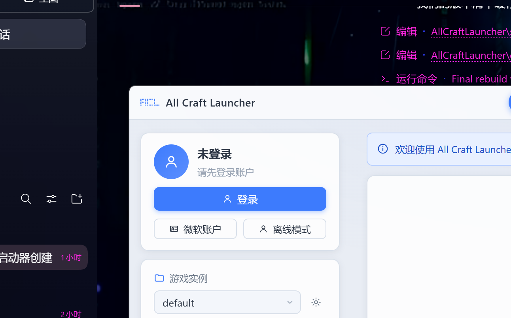

# All Craft Launcher (ACL)

> 一款开源的 Minecraft 启动器，Windows 优先。
> 界面风格灵感来自 PCL2 面板，**全部代码与素材原创**，未使用任何现有启动器的源文件。


---

## ✨ 功能特性（v0.0.1）

- **启动游戏**：离线登录 / 微软账户（OAuth 设备码流）、版本选择、实例（游戏目录）管理、内存与分辨率设置、启动日志实时输出
- **下载安装**：Mojang 官方源 / BMCLAPI 镜像一键切换，原版全版本下载安装（含资源文件、运行库、原生库）
- **模组加载器**：Fabric 一键安装（游戏版本 + 加载器版本选择）
- **Java 管理**：自动检测本机 Java、按游戏版本智能匹配 Java 大版本、Java 8 / 17 / 21 运行时自动下载
- **现代 UI**：无边框自绘标题栏、深/浅双主题、卡片式面板（PCL 风格灵感）、任务进度与取消、断点续传下载

## 🖼️ 界面预览



> 更多页面（下载 / 设置 / 关于）待补充截图。

## 📥 下载

前往 [Releases](https://github.com/yemao-maomao/All-Craft-Launcher-ACL-/releases) 页面下载最新版本：

- `AllCraftLauncher-x.x.x-portable.exe`：免安装单文件绿色版
- `AllCraftLauncher-x.x.x-setup.exe`：安装向导版

## 🔨 从源码构建

环境要求：Node.js ≥ 20（Windows）

```bash
# 1. 安装依赖（国内网络已默认走 npmmirror 镜像，海外开发者可删除 .npmrc）
npm install

# 2. 生成应用图标（依赖 Windows .NET System.Drawing）
npm run icon

# 3. 打包（产物输出到 dist/）
npm run dist            # 同时构建 portable + nsis
npm run dist:portable   # 仅免安装单文件版
npm run dist:nsis       # 仅安装向导版
```

开发模式：

```bash
npm start          # 以开发模式运行
npm run smoke      # 核心模块冒烟测试（node scripts/smoke.js 见其 help 输出）
npm run boot-test  # 集成启动测试：加载真实主进程+preload+renderer 全链路并自动校验
```

## 📂 目录结构

```
AllCraftLauncher/
├── src/
│   ├── main/          # Electron 主进程（应用壳 + IPC + 业务核心）
│   │   ├── main.js    #   入口：窗口管理、生命周期
│   │   ├── ipc.js     #   IPC 通道注册与事件转发
│   │   └── core/      #   纯 Node 业务核心（不依赖 electron，可独立测试）
│   ├── preload/       # contextBridge 安全桥（window.acl）
│   └── renderer/      # 渲染进程界面（原生 HTML/CSS/JS，零框架零构建）
├── docs/              # 设计文档（架构契约 CONTRACTS.md / UI 规格 UI-SPEC.md）
├── scripts/           # 构建辅助脚本（图标生成、冒烟测试、集成测试）
├── build/             # 打包资源（图标）
└── dist/              # 打包产物（EXE）
```

## 🗄️ 数据目录

- 便携模式：exe 同目录存在 `.portable` 标记文件时，数据保存在 exe 旁；
- 常规模式：`%APPDATA%\AllCraftLauncher\`（设置、实例、缓存、Java 运行时等）。

## 🤝 致谢

本项目为独立原创实现，界面风格与功能方向受以下社区项目启发，特此致谢：

- [HMCL](https://github.com/HMCL-dev/HMCL)（GPL-3.0）
- [PCL2](https://github.com/PCL-Community/PCL2-Language)（社区语言与核心研究仓库）
- [Fold Craft Launcher](https://github.com/FCL-Team/FoldCraftLauncher)（GPL-3.0）

## 📄 开源协议

[GPL-3.0](./LICENSE) —— 使用本项目代码请遵守相应协议。

## ⚠️ 免责声明

本项目与 Mojang Studios、微软公司无任何关联。“Minecraft” 是其商标。请支持正版。
